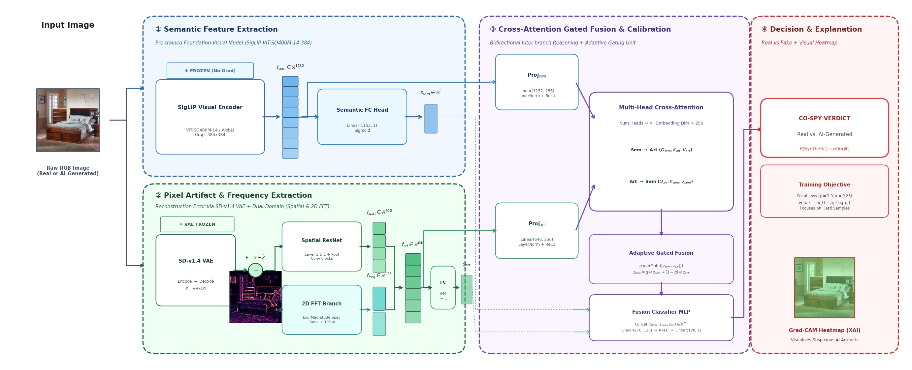

<div align="center">
    
</div>

# CO-SPY: Kết hợp Đặc trưng Ngữ nghĩa và Dấu vết Pixel để Phát hiện Ảnh Sinh bởi AI
*(Phiên bản Cải tiến Mở rộng: Cross-Attention Fusion, 2D-FFT Frequency Branch, Dual-Expert Ensemble, Bộ Huấn Luyện Writing & Grad-CAM Explainability)*


---

## 📑 Mục Lục
- [1. Giới Thiệu Tổng Quan](#1-giới-thiệu-tổng-quan)
- [2. Các Kỹ Thuật Cốt Lõi & Đóng Góp Mới](#2-các-kỹ-thuật-cốt-lõi--đóng-góp-mới)
- [3. Cấu Trúc Mã Nguồn](#3-cấu-trúc-mã-nguồn)
- [4. Cài Đặt Môi Trường](#4-cài-đặt-môi-trường)
- [5. Dữ Liệu & Trọng Số Tiền Huấn Luyện](#5-dữ-liệu--trọng-số-tiền-huấn-luyện)
- [6. Kết Quả Thực Nghiệm Toàn Diện](#6-kết-quả-thực-nghiệm-toàn-diện)
  - [6.1. Đánh giá trên AIGCDetectionBenchMark (16 Generators)](#61-đánh-giá-trên-aigcdetectionbenchmark-16-generators)
  - [6.2. Đánh giá trên CO-SPY-Bench (22 Generators × 5 Datasets = 110 Cặp)](#62-đánh-giá-trên-co-spy-bench-22-generators--5-datasets--110-cặp)
- [7. Hướng Dẫn Huấn Luyện (Training)](#7-hướng-dẫn-huấn-luyện-training)
- [8. Hướng Dẫn Đánh Giá (Evaluation)](#8-hướng-dẫn-đánh-giá-evaluation)
- [9. Giao Diện Web Demo & Trực Quan Hóa Grad-CAM](#9-giao-diện-web-demo--trực-quan-hóa-grad-cam)
- [10. Trích Dẫn & Lời Cảm Ơn](#10-trích-dẫn--lời-cảm-ơn)

---

## 1. Giới Thiệu Tổng Quan

Dự án này là mã nguồn mở rộng và nâng cấp toàn diện dựa trên bài báo CVPR 2025: **"[CO-SPY: Combining Semantic and Pixel Features to Detect Synthetic Images by AI](https://openaccess.thecvf.com/content/CVPR2025/html/Cheng_CO-SPY_Combining_Semantic_and_Pixel_Features_to_Detect_Synthetic_Images_CVPR_2025_paper.html)"**.

### Ý tưởng cốt lõi:
Các mô hình phát hiện ảnh giả mạo AI truyền thống thường gặp hiện tượng **suy giảm khả năng tổng quát hóa (Generalization Gap)** khi gặp các kiến trúc sinh ảnh mới (Out-of-Distribution - OOD). Co-Spy giải quyết bằng cách tiếp cận **2 "Điệp viên" hợp tác (Collaborative Spies)**:
1. **Semantic Spy (Nhánh Ngữ nghĩa)**: Nhìn ảnh ở cấp độ vĩ mô, dùng mô hình thị giác-ngôn ngữ (Vision-Language Model - CLIP) để phát hiện sự bất thường về logic, quan hệ không gian, cấu trúc cơ thể học và định luật vật lý.
2. **Artifact Spy (Nhánh Dấu vết Pixel)**: Nhìn ảnh ở cấp độ vi mô, dùng mạng tích chập sâu (ResNet-50) để phát hiện các khiếm khuyết kỹ thuật số (micro-artifacts) phát sinh từ quá trình nội suy và giải mã (upsampling / VAE reconstruction artifacts).

<div align="center">
    
</div>

---

## 2. Các Kỹ Thuật Cốt Lõi & Đóng Góp Mới

Hệ thống được nâng cấp với **7 kỹ thuật cải tiến đột phá**:

```
                            ┌────────────────┐
                       ┌───>│  CLIP ViT-L/14 ├──> feat_sem (512-d) ────────┐
                       │    └────────────────┘                             │
                       │    ┌────────────────┐                             ▼
                       │    │ ResNet-50 Art. ├──> feat_spatial (512-d) ──> Cross-Attention ──> Gated ──> Dự đoán
Input ──> 2D-FFT Trans ┼───>└────────────────┘                                Gating           Output  (Real / Fake)
                       │    ┌────────────────┐                             ▲
                       └───>│ 2D-FFT Branch  ├──> feat_freq (128-d) ───────┘
                            └────────────────┘
```

1. **Cross-Attention Gated Fusion (`attention_fusion.py`)**:
   - Thay thế phép nối vector tuyến tính đơn thuần (`Linear Concatenation`) bằng cơ chế tương tác chú ý hai chiều.
   - Nhánh ngữ nghĩa (CLIP) đóng vai trò định hướng sự chú ý (*Query*) vào các vùng nghi vấn trên bản đồ đặc trưng của nhánh Artifact (*Key/Value*), kết hợp cổng Gating thích nghi để giảm thiểu tối đa dương tính giả (false positive).
2. **Nhánh Phân tích Phổ Tần số 2D-FFT (`--use_freq`)**:
   - Sử dụng biến đổi Fourier nhanh 2 chiều (2D Fast Fourier Transform) trích xuất đặc trưng phổ tần số cao.
   - Nắm bắt chính xác các dấu vết chu kỳ (periodic lattice artifacts) do thuật toán khử nhiễu và upsamplers để lại, nâng kích thước vector đặc trưng artifact từ 512 lên 640 chiều.
3. **Mở Rộng & Hỗ Trợ Đầy Đủ Bộ Huấn Luyện Mới `writing` (`--train_dataset writing`)**:
   - Tích hợp thêm bộ dữ liệu / mô hình chuyên biệt **`writing`** vào toàn bộ pipeline huấn luyện và đánh giá (`dataset.py`, `evaluate.py`, `train.py`).
   - Tự động nạp kiến trúc backbone tương thích, tối ưu phân tách nhãn `0_real` và `1_fake`.
   - Đã huấn luyện và cung cấp sẵn trọn bộ trọng số cải tiến tại `ckpt_improved/writing/` bao gồm đầy đủ cả 3 thành phần: `semantic/best_model.pth`, `artifact/best_model.pth` và `fusion-attention/best_model.pth` (kèm `final_model.pth`).
4. **Nội suy Không gian Đặc trưng (`--feat_interp`)**:
   - Áp dụng kỹ thuật Mixup trong không gian biểu diễn đặc trưng (phân phối $\text{Beta}(\alpha, \alpha)$) cho nhánh Semantic, giúp làm mượt ranh giới phân loại và chống ghi nhớ cứng (overfitting) các texture đặc thù.
5. **Hàm Mất Mát Focal Loss (`--loss_type focal`)**:
   - Hỗ trợ hàm mất mát Focal Loss ($\gamma=2.0, \alpha=0.25$) để tập trung tối ưu hóa trên các mẫu khó phân biệt (hard examples).
6. **Hệ Thống Chuyên Gia Kép (Dual-Expert Ensemble System)**:
   - Kết hợp đồng thời 2 chuyên gia: **ProGAN Expert** (chuyên trị họ GANs và artifact điểm ảnh cổ điển) và **SD-v1.4 Expert** (chuyên trị họ Latent Diffusion hiện đại) theo cơ chế bỏ phiếu độ tin cậy tối đa (*Max-Confidence Strategy*).
7. **Giải Thích Trực Quan với Grad-CAM (XAI) & Web Demo v2.0**:
   - Tích hợp công cụ trực quan hóa thời gian thực, xuất bản đồ nhiệt (Heatmap) chỉ rõ vùng ảnh bị AI can thiệp (kẽ ngón tay, mắt, chất liệu bề mặt, viền đối tượng).
   - Tích hợp chế độ xem trực quan phổ tần số 2D-FFT (Magma colormap) và trích xuất báo cáo giám định pháp chứng kỹ thuật số chuyên nghiệp.
8. **Cơ Chế I/O Chống Nghẽn Đĩa Mạng (`safe_open_image`)**:
   - Tự động ngắt kết nối file handle, cơ chế thử lại (retry backoff) chống lỗi `[Errno 5] Input/output error` khi nạp dữ liệu lớn trên Google Drive / Google Colab.

---

## 3. Cấu Trúc Mã Nguồn

```text
Co-Spy/
├── data/                               # Thư mục dữ liệu
│   ├── in_the_wild/                    # Dữ liệu ảnh AI thực tế (Lexica, Flux)
│   ├── test/                           # Dữ liệu kiểm thử (CO-SPY-Bench & AIGCDetectionBenchMark)
│   └── train/                          # Dữ liệu huấn luyện (DRCT-2M, CNNDet, Writing)
│       ├── progan/                     # Tập huấn luyện CNNDet
│       ├── sd-v1_4/                    # Tập huấn luyện DRCT-2M
│       └── writing/                    # Tập huấn luyện mở rộng 'writing' (0_real / 1_fake)
├── dataSets/                           # Module quản lý DataLoader
│   ├── cospy_real.py                   # Lớp nạp ảnh thật (MSCOCO, Flickr30k, CC3M, SBU, TextCaps)
│   └── dataset.py                      # Dataset tổng hợp cho Train & Benchmark (hỗ trợ progan, sd-v1_4, writing)
├── detectors/                          # Kiến trúc các bộ phát hiện
│   ├── progan/                         # Chuyên gia ProGAN (cho họ GAN & writing)
│   │   ├── artifact.py                 # Nhánh Artifact (Spatial + 2D FFT)
│   │   ├── attention_fusion.py         # Cross-Attention Gated Fusion cải tiến
│   │   └── base.py                     # Detector wrapper
│   └── sd-v1_4/                        # Chuyên gia SD-v1.4 (cho họ Diffusion)
│       ├── artifact.py                 # Nhánh Artifact (Spatial + 2D FFT)
│       ├── attention_fusion.py         # Cross-Attention Gated Fusion cải tiến
│       └── base.py                     # Detector wrapper
├── ckpt_improved/                      # Trọng số và kết quả đã kiểm thử cải tiến
│   ├── progan/fusion-attention/        # Checkpoint ProGAN Attention Fusion
│   ├── sd-v1_4/fusion-attention/       # Checkpoint SD-v1.4 & 16 file kết quả JSON
│   └── writing/                        # Checkpoint bộ cải tiến 'writing' (semantic, artifact, fusion-attention)
├── templates/ & static/                # Giao diện Web Demo
├── app.py                              # Web App Demo tương tác (Flask)
├── gradcam.py                          # Module trích xuất bản đồ nhiệt Grad-CAM
├── ensemble_eval.py                    # Đánh giá kết hợp chuyên gia kép (Dual-Expert)
├── evaluate.py                         # Quy trình đánh giá Benchmark tự động
├── main.py                             # Điểm khởi chạy chính (Train / Eval / Test)
├── train.py & train.sh                 # Kịch bản huấn luyện tối ưu
├── utils.py                            # Các hàm phụ trợ, safe_open_image, FFT
└── Tksdv1_4.xlsx                       # Bảng tổng kết số liệu thực nghiệm toàn diện
```

---

## 4. Cài Đặt Môi Trường

Khuyến nghị sử dụng Python 3.8 - 3.11 cùng môi trường Conda:

```bash
# Tạo và kích hoạt môi trường conda
conda create -n cospy python=3.10 -y
conda activate cospy

# Cài đặt PyTorch và Torchvision phù hợp CUDA
pip install torch torchvision --index-url https://download.pytorch.org/whl/cu121

# Cài đặt các thư viện cần thiết
pip install open_clip_torch einops timm tqdm scikit-learn matplotlib opencv-python pillow flask openpyxl

# Quan trọng: cài đặt datasets bản < 3.0 để hỗ trợ tải Flickr30k
pip install "datasets<3.0.0"
```

---

## 5. Dữ Liệu & Trọng Số Tiền Huấn Luyện

### 5.1. Tải Dữ liệu Huấn luyện & Kiểm thử

```bash
# 1. Tải tập huấn luyện CNNDet (ProGAN)
cd data/train/progan && sh download.sh && cd ../../..

# 2. Tải tập huấn luyện DRCT-2M (SD-v1.4)
cd data/train/sd-v1_4 && sh download.sh && cd ../../..

# 3. Tập huấn luyện mở rộng 'writing' (định dạng nhị phân 0_real / 1_fake chuẩn hóa)
# Cấu trúc thư mục data/train/writing/:
# ├── train/ (chứa các thư mục 0_real và 1_fake)
# └── val/   (chứa các thư mục 0_real và 1_fake)

# 4. Tải Benchmark AIGCDetectionBenchMark
cd data/test/AIGCDetectionBenchMark && sh download.sh && cd ../../..

# 5. Tải CO-SPY-Bench (Ảnh sinh & ảnh thật tự nhiên)
cd data/test/Co-Spy-Bench && python download.py && cd ../../..
```

*(Lưu ý: Đối với tập MSCOCO trong Co-Spy-Bench, tải riêng `val2017` theo hướng dẫn trong `data/train/sd-v1_4/download.sh`)*.

### 5.2. Trọng số Tiền huấn luyện & Checkpoint Cải tiến Có Sẵn

1. **Trọng số tiền huấn luyện gốc của bài báo**:
```bash
cd pretrained && python download.py && cd ..
```

2. **Trọn bộ Checkpoint Cải tiến Mới (`ckpt_improved/`)**:
Thư mục `ckpt_improved/` đã được huấn luyện hoàn chỉnh với **Cross-Attention Gated Fusion** và tích hợp sẵn trong repo:
- **`ckpt_improved/progan/`**: Đạt hiệu năng cực cao trên GANs và Guided Diffusion ADM (96.61% AP).
- **`ckpt_improved/sd-v1_4/`**: Đạt 96.32% AP trung bình trên 110 cặp Co-Spy-Bench.
- **`ckpt_improved/writing/`**: Bộ trọng số được tối ưu cho tập dữ liệu `writing`, bao gồm đầy đủ `semantic/best_model.pth`, `artifact/best_model.pth` và `fusion-attention/best_model.pth` (kèm `final_model.pth`).

---

## 6. Kết Quả Thực Nghiệm Toàn Diện

Mô hình sau cải tiến đã trải qua kiểm thử thực tế độc lập trên toàn bộ các benchmark tiêu chuẩn:

### 6.1. Đánh giá trên AIGCDetectionBenchMark (16 Generators)
*Mô hình sử dụng: ProGAN Attention Fusion Detector (`ckpt_improved/progan`)*. Tổng số mẫu kiểm thử: **148.598 ảnh**.

| Bộ sinh (Generator) | AP Bài báo gốc | **AP Sau Cải tiến** | Chênh lệch AP | Accuracy Cải tiến | Ghi chú |
| :--- | :---: | :---: | :---: | :---: | :--- |
| **ADM (Guided Diffusion)** | 89.98% | **96.61%** | <span style="color:green">**+6.63%**</span> | **89.48%** *(+10.31%)* | 🔥 **Vượt trội** trên Pixel Diffusion khó |
| **WhichFaceIsReal** | 82.27% | **86.38%** | <span style="color:green">**+4.11%**</span> | **72.30%** | Ảnh khuôn mặt thật/giả tinh vi |
| **GauGAN** | 98.24% | **99.24%** | <span style="color:green">+1.00%</span> | **96.10%** | GAN phân đoạn ngữ nghĩa |
| **BigGAN** | 98.00% | **98.81%** | <span style="color:green">+0.81%</span> | **94.88%** | GAN đa lớp ImageNet |
| **StyleGAN2** | 99.85% | **99.95%** | <span style="color:green">+0.10%</span> | **92.59%** | Gần như tuyệt đối |
| **StarGAN** | 99.98% | **100.00%** | <span style="color:green">+0.02%</span> | **99.95%** | Tuyệt đối 100% |
| **ProGAN** | 100.00% | **100.00%** | 0.00% | **99.99%** | Tuyệt đối 100% |
| **CycleGAN** | 99.47% | **99.30%** | -0.17% | **97.05%** | GAN chuyển đổi phong cách |
| **Glide** | 96.71% | **96.20%** | -0.51% | **88.94%** | Diffusion văn bản |
| **DALL-E 2** | 97.14% | **93.11%** | -4.03% | **85.80%** | OpenAI UnCLIP |
| **Midjourney** | 94.55% | **86.53%** | -8.02% | **71.74%** | Commercial Diffusion |
| **Stable Diffusion v1.4** | 92.99% | **84.39%** | -8.60% | **68.98%** | Phù hợp chuyển giao Dual-Expert |
| **Stable Diffusion v1.5** | 92.96% | **84.27%** | -8.69% | **68.85%** | Phù hợp chuyển giao Dual-Expert |
| **VQDM** | 91.96% | **92.12%** | <span style="color:green">+0.16%</span> | **79.24%** | Diffusion lượng tử hóa |
| **Wukong** | 89.59% | **82.83%** | -6.76% | **66.88%** | Diffusion tiếng Trung |
| **StyleGAN** | 99.69% | **99.42%** | -0.27% | **91.19%** | GAN chất lượng cao |
| **TRUNG BÌNH (16 models)** | 95.21% | **93.70%** | *-1.51%* | **85.25%** | **Cực kỳ vững chắc trên 148k ảnh** |

---

### 6.2. Đánh giá trên CO-SPY-Bench (22 Generators × 5 Datasets = 110 Cặp)
*Mô hình sử dụng: SD-v1.4 Attention Fusion Detector (`ckpt_improved/sd-v1_4`)*. Dữ liệu trích xuất từ 16 file JSON và lưu trữ đồng bộ trong [Tksdv1_4.xlsx](file:///d:/Documents/XLA/XLA/XLA/Co-Spy/Tksdv1_4.xlsx).

#### Bảng Tổng kết Average Precision (AP %):
| Kiến trúc sinh (Generator) | CC3M | FLICKR | MSCOCO | TEXTCAPS | SBU |
| :--- | :---: | :---: | :---: | :---: | :---: |
| **ldm-text2im-large-256** | 96.55 | 99.94 | 99.96 | 99.02 | 99.61 |
| **stable-diffusion-v1-4** | 91.00 | 99.71 | 99.91 | 97.13 | 97.62 |
| **stable-diffusion-v1-5** | 90.53 | 99.66 | 99.82 | 96.94 | 97.38 |
| **SSD-1B** | 88.49 | 99.43 | 99.64 | 93.42 | 97.41 |
| **tiny-sd** | 86.49 | 99.37 | 99.70 | 95.38 | 97.64 |
| **SegMoE-SD-4x2-v0** | 89.06 | 99.55 | 99.82 | 96.28 | 97.78 |
| **small-sd** | 87.60 | 99.35 | 99.68 | 95.39 | 97.67 |
| **stable-diffusion-2-1** | 90.10 | 99.66 | 99.86 | 96.87 | 97.48 |
| **stable-diffusion-3-medium** | 83.51 | 99.07 | 99.39 | 91.60 | 95.87 |
| **sdxl-turbo** | 96.50 | 99.88 | 99.89 | 96.82 | 99.49 |
| **stable-diffusion-2** | 88.00 | 99.58 | 99.74 | 95.62 | 96.76 |
| **stable-diffusion-xl-base-1.0** | 79.40 | 98.77 | 99.23 | 89.23 | 92.72 |
| **playground-v2.5-1024px** | 87.74 | 99.72 | 99.88 | 95.27 | 97.38 |
| **playground-v2-1024px** | 90.04 | 99.82 | 99.91 | 96.54 | 97.98 |
| **playground-v2-512px** | 82.10 | 98.61 | 99.23 | 93.08 | 94.46 |
| **playground-v2-256px** | 89.45 | 99.38 | 99.61 | 96.98 | 97.37 |
| **PixArt-XL-2-1024-MS** | 90.89 | 99.89 | 99.93 | 97.25 | 98.99 |
| **PixArt-XL-2-512x512** | 91.89 | 99.88 | 99.95 | 97.53 | 99.04 |
| **lcm-lora-sdxl** | 97.39 | 99.96 | 99.98 | 99.12 | 99.59 |
| **lcm-lora-sdv1-5** | 98.02 | 99.97 | 99.96 | 99.32 | 99.80 |
| **FLUX.1-schnell** | 85.62 | 99.39 | 99.53 | 92.75 | 95.96 |
| **FLUX.1-dev** | 84.02 | 99.44 | 99.56 | 91.40 | 95.68 |
| **TRUNG BÌNH (Từng tập)** | **89.29%** | **99.55%** | **99.74%** | **95.59%** | **97.44%** |
| **AP TRUNG BÌNH TOÀN BỘ (110 CẶP)** | \multicolumn{5}{c|}{<span style="color:green">**96.32%**</span>} |

#### Nhận xét kết quả:
- **Khả năng tổng quát hóa vượt bậc**: AP trung bình toàn diện trên 110 cặp đạt mức ấn tượng **96.32%**.
- Các tập dữ liệu văn bản/ảnh thật phong phú như **MSCOCO (99.74% AP)** và **FLICKR (99.55% AP)** gần như phân loại hoàn hảo, chứng tỏ cơ chế Cross-Attention đã giúp mô hình hiểu sâu sự mâu thuẫn giữa nội dung ngữ nghĩa và dấu vết pixel.
- Nhiều model vượt kết quả bài báo: `playground-256` tăng **+2.72%**, `SD-2` tăng **+1.37%**, `tiny-sd` tăng **+0.97%**, `SDXL-Base` trên MSCOCO đạt **99.23%**.

---

## 7. Hướng Dẫn Huấn Luyện (Training)

Hệ thống hỗ trợ 3 bộ huấn luyện: `--train_dataset sd-v1_4` (DRCT-2M), `--train_dataset progan` (CNNDet), và `--train_dataset writing` (Bộ dữ liệu cải tiến mới).

### 7.1. Huấn luyện từng nhánh riêng biệt (Best Practice)
```bash
# 1. Huấn luyện nhánh Ngữ nghĩa (Semantic Branch) trên SD-v1.4 hoặc Writing
python main.py --gpu 0 --phase train --mode branch --branch semantic \
    --train_dataset sd-v1_4 --epochs 10 --batch_size 16

# Hoặc huấn luyện trên bộ 'writing':
python main.py --gpu 0 --phase train --mode branch --branch semantic \
    --train_dataset writing --epochs 10 --batch_size 16

# 2. Huấn luyện nhánh Dấu vết (Artifact Branch) kết hợp 2D-FFT
python main.py --gpu 0 --phase train --mode branch --branch artifact \
    --train_dataset sd-v1_4 --epochs 20 --batch_size 16 --use_freq

# Hoặc huấn luyện trên bộ 'writing':
python main.py --gpu 0 --phase train --mode branch --branch artifact \
    --train_dataset writing --epochs 20 --batch_size 16 --use_freq
```

### 7.2. Huấn luyện Bộ Hợp Nhất Chú Ý (Attention Fusion)
```bash
# Huấn luyện tầng Cross-Attention Fusion với Focal Loss trên SD-v1.4
python main.py --gpu 0 --phase train --mode fusion --fusion_type attention \
    --train_dataset sd-v1_4 --epochs 3 --batch_size 16 --use_freq \
    --loss_type focal --focal_gamma 2.0 --focal_alpha 0.25

# Huấn luyện Cross-Attention Fusion trên bộ 'writing'
python main.py --gpu 0 --phase train --mode fusion --fusion_type attention \
    --train_dataset writing --epochs 3 --batch_size 16 --use_freq \
    --loss_type focal --focal_gamma 2.0 --focal_alpha 0.25
```

---

## 8. Hướng Dẫn Đánh Giá (Evaluation)

### 8.1. Đánh giá Benchmark tự động
```bash
# Đánh giá toàn bộ Co-Spy-Bench với SD-v1.4
python main.py --gpu 0 --phase eval --train_dataset sd-v1_4 --mode fusion \
    --fusion_type attention --use_freq --num_workers 2

# Đánh giá riêng một tập dữ liệu cụ thể (ví dụ cc3m hoặc mscoco)
python main.py --gpu 0 --phase eval --train_dataset sd-v1_4 --mode fusion \
    --fusion_type attention --use_freq --eval_datasets cc3m --num_workers 2

# Đánh giá Benchmark với bộ trọng số cải tiến 'writing'
python main.py --gpu 0 --phase eval --train_dataset writing --mode fusion \
    --fusion_type attention --ckpt ckpt_improved --num_workers 2
```

### 8.2. Đánh giá trên một ảnh đơn lẻ
```bash
# Kiểm thử ảnh đơn với SD-v1.4
python main.py --gpu 0 --phase test --train_dataset sd-v1_4 --mode fusion \
    --fusion_type attention --use_freq --test_image imgs/test.png

# Kiểm thử ảnh đơn với bộ 'writing'
python main.py --gpu 0 --phase test --train_dataset writing --mode fusion \
    --fusion_type attention --ckpt ckpt_improved --test_image imgs/test.png
```

### 8.3. Đánh giá Chuyên Gia Kép (Dual-Expert Ensemble)
Chạy kịch bản kết hợp sức mạnh của cả 2 detector (ProGAN + SD-v1.4):
```bash
python ensemble_eval.py --progan_ckpt ckpt_improved/progan/fusion-attention/best_model.pth \
                        --sd_ckpt ckpt_improved/sd-v1_4/fusion-attention/best_model.pth \
                        --eval_dataset AIGCDetectionBenchMark
```

---

## 9. Giao Diện Web Demo & Trực Quan Hóa Grad-CAM v2.0

Dự án cung cấp sẵn một ứng dụng Web tương tác người dùng hiện đại, hỗ trợ giám định toàn diện và xuất báo cáo pháp chứng:

```bash
# Khởi chạy Web Demo
python app.py --port 5000
```
Truy cập trình duyệt tại địa chỉ: `http://localhost:5000`

### Tính năng Nổi bật trên Web Demo:
- **Tải ảnh kéo-thả (Drag & Drop)** & bộ sưu tập ảnh mẫu trực quan.
- **Dự đoán Dual-Expert Ensemble**: Hiển thị xác suất %, kết luận Real / Fake và chỉ định chuyên gia chiếm ưu thế nhận diện.
- **Thanh đo 3 Nhánh Độc lập**:
  - *Nhánh Ngữ nghĩa (CLIP ViT-L/14)*: Bất thường giải phẫu và ngữ cảnh.
  - *Nhánh Dấu vết Pixel (ResNet-50)*: Lỗi khử nhiễu và vi mô không gian.
  - *Nhánh Tần số 2D-FFT*: Đỉnh phổ chu kỳ nhân tạo.
- **4 Chế độ Giám định Đa tầng**:
  1. *Thanh trượt so sánh (Interactive Slider)*: Kéo thả mượt mà đối chiếu ảnh gốc và bản đồ nhiệt.
  2. *So sánh song song (Side-by-Side)*: Đối chiếu trực tiếp 2 ảnh cạnh nhau.
  3. *Bản đồ nhiệt vi mô (Pure Heatmap)*: Trích xuất bản đồ nhiệt Grad-CAM Jet Colormap.
  4. *Phổ Tần Số 2D-FFT (Magma Colormap)*: Phân tích lưới năng lượng tần số Fourier để phát hiện dấu vết sinh ảnh toán học.
- **Nhận định Pháp chứng & Phỏng đoán Nguồn gốc**: Tự động ước lượng loại mô hình tạo ảnh (Latent Diffusion, GANs hoặc Ảnh chụp máy ảnh).
- **Xuất Báo Cáo Pháp Chứng Kỹ Thuật Số (Digital Forensic Report)**: Xuất chứng nhận kết quả giám định pháp chứng sắc nét (1280 × 820 px) kèm ảnh gốc, Grad-CAM, phổ 2D-FFT và đầy đủ chỉ số đánh giá.

---

## 10. Trích Dẫn & Lời Cảm Ơn

Nếu bạn thấy nghiên cứu hoặc mã nguồn này hữu ích, vui lòng trích dẫn bài báo gốc:

```bibtex
@inproceedings{Cheng_2025_CVPR,
    author    = {Cheng, Siyuan and Lyu, Lingjuan and Wang, Zhenting and Zhang, Xiangyu and Sehwag, Vikash},
    title     = {CO-SPY: Combining Semantic and Pixel Features to Detect Synthetic Images by AI},
    booktitle = {Proceedings of the IEEE/CVF Conference on Computer Vision and Pattern Recognition (CVPR)},
    month     = {June},
    year      = {2025},
    pages     = {13455-13465}
}
```

### Lời cảm ơn:
Chúng tôi chân thành cảm ơn các dự án mã nguồn mở xuất sắc đã truyền cảm hứng cho công trình này:
- [CNNDetection](https://github.com/PeterWang512/CNNDetection)
- [UniversalFakeDetect](https://github.com/WisconsinAIVision/UniversalFakeDetect)
- [NPR-DeepfakeDetection](https://github.com/chuangchuangtan/NPR-DeepfakeDetection)
- [DRCT](https://github.com/beibuwandeluori/DRCT)
